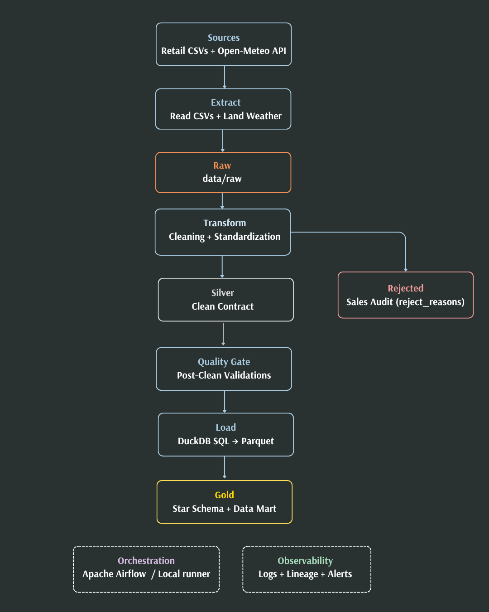

# Retail Weather ETL

Local-first ETL pipeline that transforms messy retail sales and daily weather data into auditable analytical outputs for city- and category-level analysis.

<p align="center">
  
</p>

## The Problem

A retail team wants to know whether daily weather conditions affect sales across cities and product categories.

This project simulates that question end to end. It ingests intentionally messy retail and weather data, cleans and validates both, and publishes analytical outputs that make it possible to compare sales behavior under different weather conditions.

The goal is not to claim causal inference from a real production dataset. The goal is to demonstrate how to design a reproducible ETL pipeline that turns noisy raw inputs into trustworthy outputs with explicit quality rules, auditability, and documented trade-offs.

## Architecture

The pipeline follows a layered ETL design:

`raw -> profiling -> cleaning -> validation -> SQL modeling -> published outputs`

Raw retail CSVs and daily weather data are ingested into a local pipeline, profiled, cleaned into trusted `silver` datasets, validated through structural and quality checks, modeled in DuckDB, and exported as business-ready `gold` outputs.

Airflow in Docker runs the same logical ETL in orchestrated mode, while the local Python entrypoint remains the simplest way to run and inspect the project.

Detail is in [docs/ARCHITECTURE.md](docs/ARCHITECTURE.md).

## Decisions Worth Defending

Three choices that change what the outputs mean. The full record is in [docs/DECISIONS.md](docs/DECISIONS.md).

Revenue in `fact_sales` and `weather_sales_mart` uses the current cleaned product price at refresh time, not a guaranteed historical sale-time price. The source does not publish a stable price snapshot per sale, so `total_revenue` and `avg_ticket` are analytical estimates rather than historical billed revenue. If a product price changes in the source, a full refresh recalculates past analytical revenue with the latest valid price.

Invalid sales are not silently dropped. The pipeline splits sales into clean and rejected outputs and publishes explicit `reject_reasons` for rows that fail business or relational rules. Gold models only use the clean sales contract, while rejected rows remain available for audit and root-cause analysis.

The mart is stricter than the fact table. `fact_sales` keeps otherwise valid sales even when weather is missing or price is unusable, because coverage gaps should remain visible. `weather_sales_mart` excludes rows whose customer city is still unknown, because the mart is explicitly city-grained and those rows cannot be aggregated honestly at that level.

## What It Publishes

The pipeline publishes three contracts. `silver` is the clean public contract consumed by SQL, `rejected` is the audit contract for invalid sales, and `gold` is the analytical star schema and mart layer.

Main published datasets today are:

- `dim_customers`
- `dim_products`
- `dim_weather`
- `fact_sales`
- `weather_sales_mart`

The main analytical mart is `weather_sales_mart`, published at the grain of one row per `sale_date`, `city`, and `category`. It is designed to support analysis of sales behavior under different weather conditions.

The published contract for grain, metrics, compatibility rules, and validation expectations is in [docs/DATA_CONTRACT.md](docs/DATA_CONTRACT.md).

## How to Check It

Local checks do not need external infrastructure. `uv run python -m pytest -q` runs the unit and integration suites: cleaning rules, the silver contract, the quality gate, and the DuckDB model. The command list below is that path. Suites are in [docs/TESTING.md](docs/TESTING.md).

## What I Would Do Next

- add historical sale-time pricing instead of deriving analytical revenue from the current product catalog price
- evolve the full-refresh design toward incremental loads when scale or history retention requires it
- introduce partitioned outputs and stronger run isolation for safer concurrent orchestration
- expand analytical marts with more explicit business KPIs and stakeholder-facing examples
- add richer observability for trend monitoring across runs, not only per-run validation and lineage

## Core Stack

### Runtime & data

- `Python 3.11`
- `pandas` and `numpy`
- `DuckDB` and `PyArrow`
- `Pydantic`, `Pandera`, and `PyYAML`
- `requests`
- optional `Airflow` + `Docker` runtime

### Quality & CI

- `pytest` (unit + integration)
- `ruff`, `black`, and `mypy`
- `bandit` and `pip-audit`
- `uv` for dependency management
- GitHub Actions on push/PR (Python 3.11 + 3.12)

## Key Commands

### Setup

Base environment:

```bash
uv sync --locked
```

Make shortcut:

```bash
make setup-dev
```

Full environment, including security tools:

```bash
uv sync --locked --all-groups
```

### Run

```bash
uv run python -m pipelines.pipeline
```

Optional offline run using the existing `data/raw/weather_daily.csv`:

```bash
uv run python -c "from pipelines.pipeline import run_pipeline; run_pipeline(fetch_weather=False)"
```

### Test

```bash
uv run python -m pytest -q
uv run python -m pytest -q tests/unit
uv run python -m pytest -q -m integration
```

Make shortcuts:

```bash
make test
make test-unit
make test-integration
```

### Code Quality and Security

```bash
uv run ruff check .
uv run black --check .
uv run mypy
uv run bandit -r etl pipelines dags
uv sync --locked --no-default-groups --group security
uv run --no-sync pip-audit
```

These checks complement the test suite:

- `ruff`, `black`, and `mypy` cover code quality and type safety
- `bandit` and `pip-audit` cover static security checks and dependency auditing

### Airflow

`make env-init` copies `.env.example` and sets `AIRFLOW_UID` to your `id -u`.
`make airflow-start` also creates `logs/airflow` so Docker does not create that bind mount as root.
If `.env` already exists, add `POSTGRES_USER`, `POSTGRES_PASSWORD`, and `POSTGRES_DB` from `.env.example` before starting Compose.

```bash
make env-init
make airflow-start
```

Stop everything with `make airflow-down`.

Airflow defaults to offline weather mode and reuses the existing `data/raw/weather_daily.csv`.
Set `RETAIL_ETL_FETCH_WEATHER=true` in `.env` only when you want the DAG to refresh weather from the API during `extract`.

UI (in a Codespace, forward port `8080`; Compose binds `127.0.0.1:8080` on the host):

- URL: `http://127.0.0.1:8080`
- Username: `admin`
- Password: `change_me` (from `.env.example`; change it in `.env` before the first `airflow-init`)

The DAG starts paused. Unpause and trigger it from the UI, or:

```bash
cd docker
docker compose --env-file ../.env exec airflow-scheduler airflow dags unpause retail_weather_etl
docker compose --env-file ../.env exec airflow-scheduler airflow dags trigger retail_weather_etl
```

A green run writes `data/processed/silver/`, `data/processed/gold/parquet/`, and `logs/etl/lineage/`.

If a previous failed start left `logs/` owned by root:

```bash
sudo chown -R "$(id -u):$(id -g)" logs
make airflow-start
```

## Published Layers

- `data/raw`: retail CSV inputs plus landed `weather_daily.csv`
- `data/processed/silver`: cleaned public pre-SQL datasets
- `data/processed/rejected`: rejected sales rows with `reject_reasons`
- `data/processed/gold`: exported star schema tables and analytical mart

Core gold datasets:

- `dim_customers`
- `dim_products`
- `dim_weather`
- `fact_sales`
- `weather_sales_mart`

## Documentation

- Architecture: [docs/ARCHITECTURE.md](docs/ARCHITECTURE.md)
- Technical decisions: [docs/DECISIONS.md](docs/DECISIONS.md)
- Runbook: [docs/RUNBOOK.md](docs/RUNBOOK.md)
- Data contract: [docs/DATA_CONTRACT.md](docs/DATA_CONTRACT.md)
- Testing guide: [docs/TESTING.md](docs/TESTING.md)

## Diagrams

- [Data flow diagram](docs/images/data_flow.png)
- [Data layers diagram](docs/images/data_layers.png)
- [Local execution flow](docs/images/local_execution_flow.png)
- [Airflow orchestrated flow](docs/images/airflow_orchestrated_flow.png)
